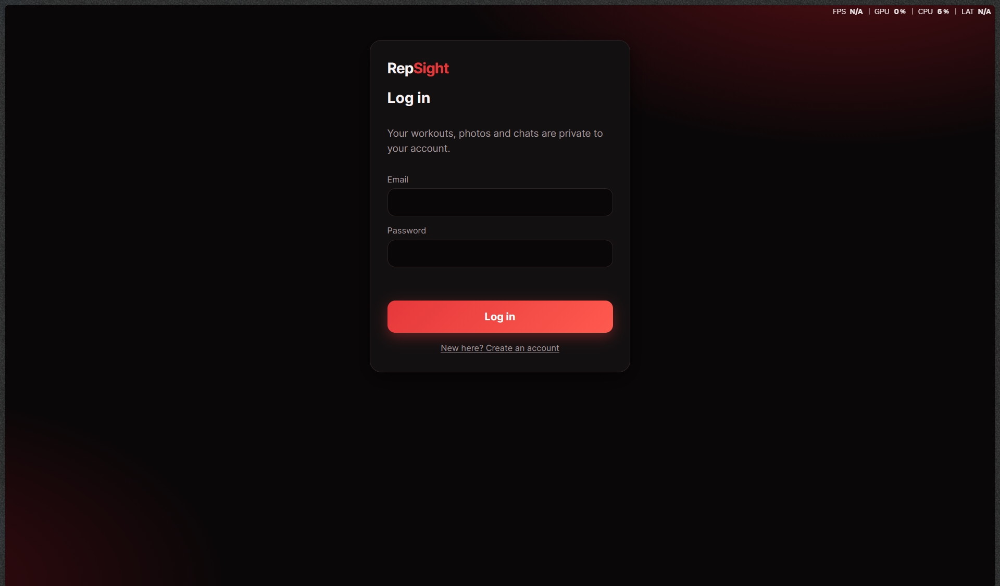
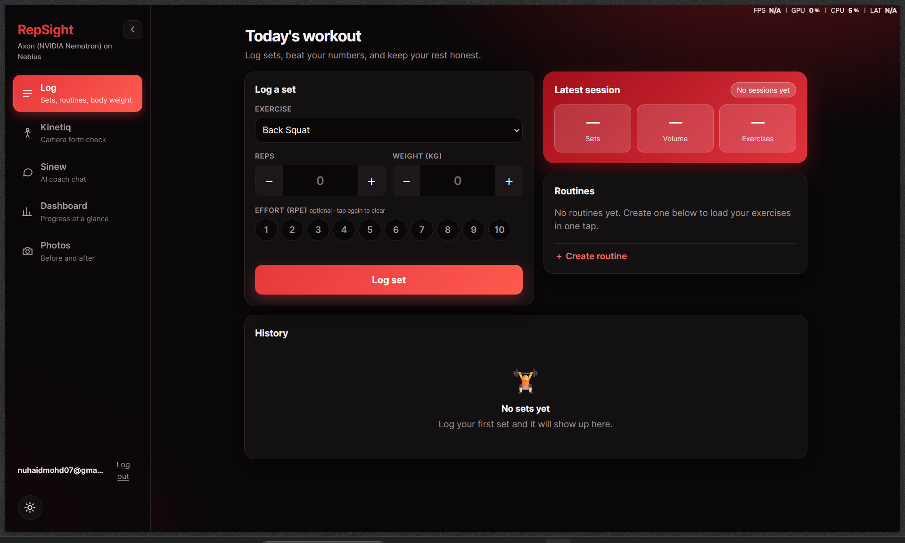
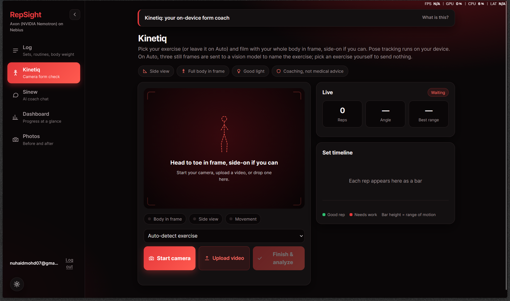
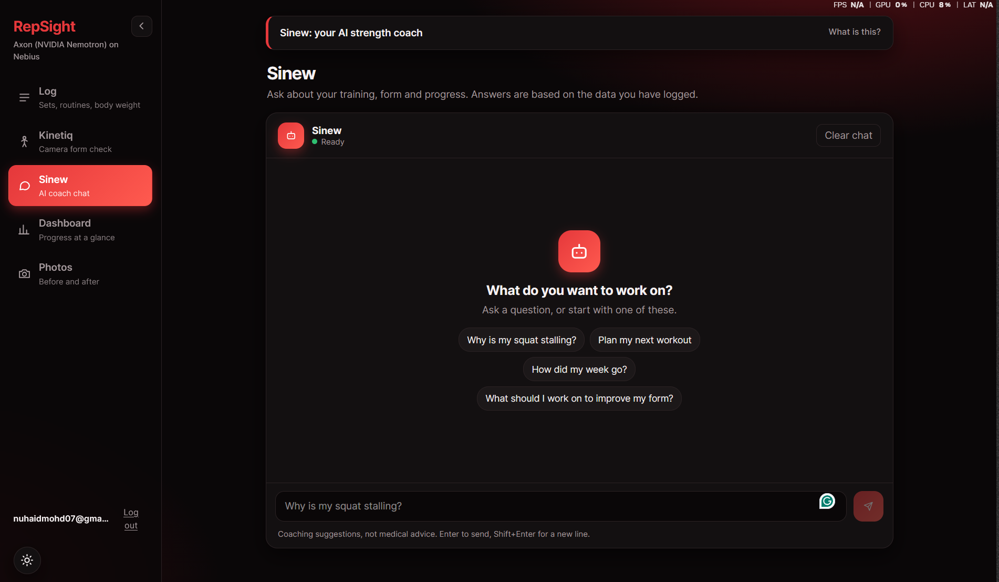
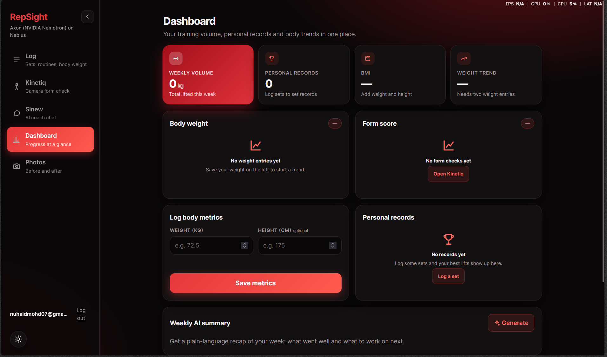
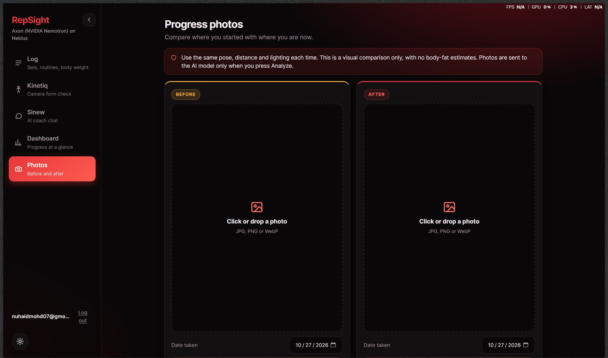

# RepSight- NVIDIA x Nebius hackathon

**An AI coach that watches your form and learns from your own training data.**
Built for the NVIDIA x Nebius hackathon.

**Live demo: https://repsight.onrender.com**
It runs on a free server that sleeps when idle, so the first load can take about a minute. Sign-up sends a real email code, so use an address you can open.

| | |
| --- | --- |
| **Kinetiq** | Film a set or upload a clip. Pose tracking runs in your browser, counts reps, flags form problems and writes plain-language feedback. |
| **Sinew** | An AI strength coach (NVIDIA Nemotron on Nebius) that answers from *your* logged sets, body metrics and form results. |
| **Log + Dashboard** | Sets, routines, weekly volume, personal records, bodyweight and BMI, form-score trend, plateau detection and an AI weekly summary. |
| **Photos** | Before/after timeline with a compare slider and a cautious AI comparison (never body-fat estimates). |

## Screenshots

| Sign-up | Log | Kinetiq |
| --- | --- | --- |
|  |  |  |

| Sinew (coach) | Dashboard | Photos |
| --- | --- | --- |
|  |  |  |

## How the AI is used

| Where | Model | Runs on | What it does |
| --- | --- | --- | --- |
| Sinew coach chat | **NVIDIA Nemotron 3 Super 120B** (`nvidia/nemotron-3-super-120b-a12b`) | Nebius Token Factory | Answers using the user's own data, streamed |
| Form and weekly summaries | **NVIDIA Nemotron 3 Nano 30B** (`NVIDIA-Nemotron-3-Nano-30B-A3B`) | Nebius Token Factory | Turns rep numbers into 2 to 3 sentences of feedback |
| Exercise detection, photo comparison | Google Gemma 3 27B (`google/gemma-3-27b-it`) | Nebius Token Factory | The only image-capable model used (the NVIDIA models on Nebius do not accept images) |
| Pose and rep counting | MediaPipe BlazePose (full / heavy) | **In your browser** | 33 body points per frame; the video never leaves your device |

## Architecture

```
Browser (Vite + TypeScript)
 ├─ MediaPipe PoseLandmarker (BlazePose), on-device
 ├─ repCounter.ts: rep counting + per-exercise form rules on 3D joint angles
 └─ follows one person at a time; tap the video to choose who
        │  JSON /api/*  (+ streamed text for the coach)
FastAPI (backend/)  ── serves the website and the API
 ├─ PostgreSQL (Neon) in production, SQLite locally: accounts, workouts, encrypted photos
 ├─ Nebius Token Factory (Nemotron, Gemma) over an OpenAI-compatible API
 └─ Brevo web API: sign-up codes by email
Hosting: Render (free web service, Docker) + Neon (free Postgres) + Brevo (free email)
```

### Kinetiq in detail
- Pose gives joint positions only. A hysteresis state machine on one joint angle decides what a rep is, using 3D angles so the camera angle matters less.
- Presets: squat, deadlift/hinge, push-up, chest press, biceps curl, dumbbell raise, overhead press. Leave it on **Auto** and a vision model names the exercise from three frames.
- Posture flags (torso lean, elbow drift, body line) are measured on side-on frames. Per-rep results go to the backend, which counts the flags and has the language model write the summary.
- With several people in frame it follows one; click a person to switch.

## Security and privacy

- **Accounts:** email plus a 6-digit code sent to the address (with DNS, typo and placeholder-domain checks), passwords hashed with scrypt, 14-day sessions in an HttpOnly cookie.
- **Per-user encryption:** every user has their own data key, stored only wrapped by their password. Photos, coach chats, form results, age and phone are encrypted with it. Workout numbers stay readable by the database owner (the dashboard queries need them) but every row is tied to its owner and every query is scoped.
- **Hardening:** rate limits, cross-site request checks, a Content-Security-Policy, input limits, real image-type checks, generic error messages, and a production mode that refuses to start without working email or a database.
- **What leaves your device:** nothing during pose tracking. On Auto, three small still frames go to the vision model. A photo goes to the vision model only when you press Analyze. The coach sees your age and training data, never your phone number.
- **Your data:** `DELETE /api/data` wipes your data; `DELETE /api/account` removes the account.
- **Tested:** 118 automated tests (`tests/`), run against both SQLite and PostgreSQL, cover access control, user separation, uploads, injection, encryption at rest, sign-up, rate limits and deployment settings.

## Run locally

Requires Python 3.11+ and Node 20+.

```powershell
# 1. Backend (project root)
python -m venv .venv
.venv\Scripts\Activate.ps1          # macOS/Linux: source .venv/bin/activate
pip install -r requirements.txt
copy .env.example .env              # then add your NEBIUS_API_KEY
cd backend
uvicorn main:app --port 8080

# 2. Frontend (second terminal)
cd frontend-ts
npm install
npm run dev                         # open http://localhost:5173
```

Vite forwards `/api` to the backend on port 8080. Or run `npm run build` in `frontend-ts` and open http://localhost:8080.

Without email settings, sign-up codes are printed in the backend terminal (development only). The camera works on `localhost` or https; uploading a video works anywhere.

### Tests
```powershell
pip install pytest httpx
pytest tests                                    # SQLite
$env:DATABASE_URL="postgresql://..."; pytest tests   # PostgreSQL
```

## Configuration (`.env`)

| Variable | Purpose |
| --- | --- |
| `NEBIUS_API_KEY`, `NEBIUS_BASE_URL` | Nebius Token Factory key and endpoint (`https://api.tokenfactory.nebius.com/v1/`). Never commit the key. |
| `COACH_MODEL`, `SUMMARY_MODEL`, `VISION_MODEL` | Model names (see the table above) |
| `DATABASE_URL` | Postgres address (Neon). Empty means a local SQLite file. |
| `BREVO_API_KEY`, `BREVO_SENDER_EMAIL` | Email through Brevo's web API (works on hosts that block SMTP) |
| `SMTP_*` | Or email over SMTP, for example Gmail with an app password |

`python backend/send_test_email.py you@gmail.com` sends one test email and explains any failure. More settings (production, proxies, photo size) are in [deploy/README.md](deploy/README.md).

## Deploying

The live site runs free on **Render** with a **Neon** database and **Brevo** email. Step by step, with a checker script and two alternatives (your PC through a Cloudflare tunnel, or your own server): [deploy/README.md](deploy/README.md).

## API

| Area | Endpoints |
| --- | --- |
| Accounts | `POST /api/auth/signup/start`, `/signup/verify`, `/login`, `/logout`, `GET /api/auth/me`, `DELETE /api/account` |
| Workouts | `GET /api/exercises`, `GET`/`POST /api/sets`, `POST /api/metrics` |
| Routines | `GET`/`POST /api/routines`, `DELETE /api/routines/{id}` |
| Dashboard | `GET /api/dashboard`, `GET /api/summary` |
| Kinetiq | `POST /api/form`, `POST /api/identify` |
| Sinew | `POST /api/coach` (streamed) |
| Photos | `GET`/`POST /api/photos`, `GET /api/photos/{id}/file`, `DELETE /api/photos[/{id}]`, `POST /api/photos/analyze` |
| Reference data | `GET /api/meta/countries`, `GET /api/meta/email-domains` |
| Reset | `DELETE /api/data` |

## Honest limits

- Rep counting and form thresholds are starting estimates and have **not** been validated against labelled clips.
- It works best with a mostly side-on camera at about chest height and the whole body in frame. Machine exercises hide part of the body, so pick the exercise manually.
- Shrugs are not supported, and the app tracks the body only: it does not detect the dumbbell, bar or machine.
- The free hosting sleeps after 15 minutes idle. Sign-up emails from a Gmail sender can land in spam until a domain you own is verified with the email provider.
- A developer with access to the running server can see more than users might expect: workout numbers are not encrypted, and the server holds a user's key while they are logged in.
- Coaching suggestions, not medical advice. No body-fat estimates.
